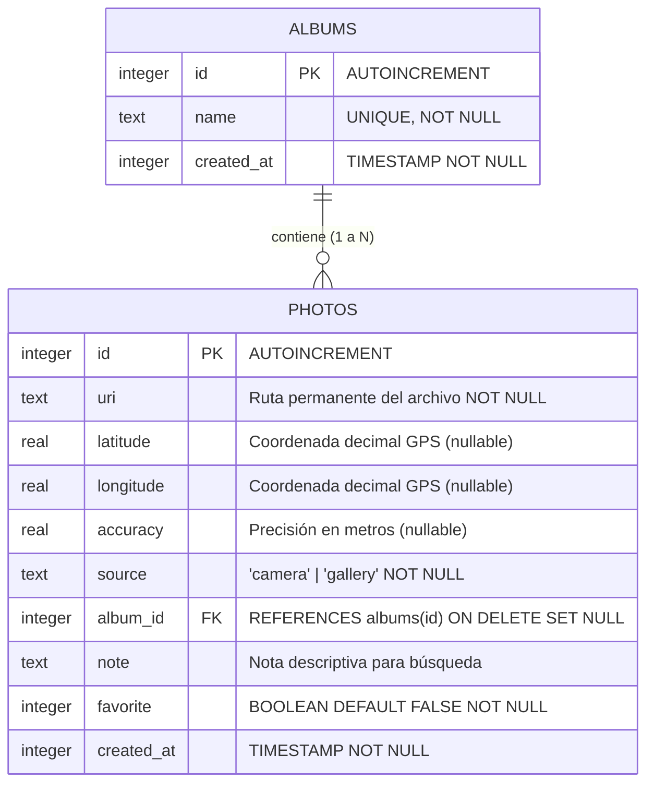
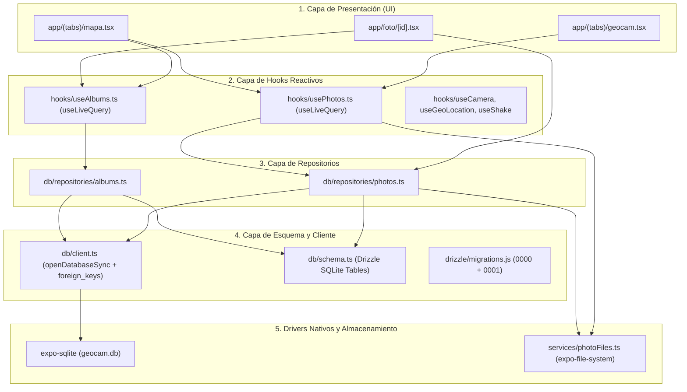

# GeoCam 📷📍 — Base de Datos Local Offline-First con Drizzle ORM y SQLite

**Taller Integrador 2 — Semana 7**  
**Estudiante(s):** Juan Carlos Áñez, Andres García  
**Tecnologías:** React Native 0.86, Expo SDK 57, TypeScript, Drizzle ORM, Drizzle Kit, Expo SQLite, Expo FileSystem (Class-based API), Expo Camera, Expo Location, Expo Sensors, React Native Maps.

GeoCam es una aplicación móvil nativa con arquitectura **Offline-First**. Captura fotografías geolocalizadas, visualiza capturas en un mapa interactivo con miniaturas, organiza fotos en álbumes, permite notas y favoritos, responde a gestos físicos del acelerómetro (*shake*) y persiste tanto los metadatos relacionales en **SQLite** como los archivos binarios de forma permanente en el almacenamiento de documentos del dispositivo.

---

## 🏛️ Diagrama de Entidad-Relación (Base de Datos Local)

La base de datos SQLite gestionada por Drizzle ORM implementa una relación **1 a N** entre álbumes y fotografías, con integridad referencial y borrado no destructivo (`ON DELETE SET NULL`):



> **Garantía referencial:** Al eliminar un álbum, sus fotografías **permanecen intactas** en la base de datos y su campo `album_id` pasa automáticamente a `NULL`. Esto se garantiza mediante la ejecución preventiva de `PRAGMA foreign_keys = ON;` al inicializar la base de datos SQLite.

---

## 🏗️ Arquitectura en 5 Capas

El proyecto sigue una separación estricta de responsabilidades en 5 capas. Las pantallas de interfaz nunca interactúan directamente con la base de datos:



### Funciones de cada capa:
1. **Presentación (`app/`):** Componentes visuales de Expo Router. Consumen hooks reactivos para renderizar listas, mapa, filtros y formularios.
2. **Hooks Reactivos (`hooks/`):** Utilizan `useLiveQuery` de Drizzle para sincronizar automáticamente el estado de la UI con la base de datos sin requerir refrescos manuales.
3. **Repositorios (`db/repositories/`):** Encapsulan la lógica de consulta SQL (filtros combinados `like`, `eq`, `isNotNull`, inserciones, actualizaciones y borrados coordinados).
4. **Esquema y Cliente (`db/` y `drizzle/`):** Configuración de Drizzle con Expo SQLite, definición de tablas tipadas y ejecución de migraciones automáticas mediante `useMigrations`.
5. **Drivers Nativos:** `expo-sqlite` con `enableChangeListener: true` y `expo-file-system` mediante sus nuevas clases orientadas a objetos (`Directory`, `File`, `Paths`).

---

## 📂 Estructura del Código

```
semana6-geocam/
├── app/
│   ├── (tabs)/
│   │   ├── _layout.tsx           # Pestañas inferiores con shake to clear
│   │   ├── geocam.tsx            # Cámara con visor, GPS y persistencia SQLite
│   │   └── mapa.tsx              # Mapa con filtros reactivos, búsqueda y pines
│   ├── foto/
│   │   └── [id].tsx              # Pantalla CRUD: visualización, notas, favs, álbum y borrado
│   ├── _layout.tsx               # Protección de arranque con useMigrations y seed
│   └── +not-found.tsx            # Ruta 404
├── db/
│   ├── client.ts                 # Instancia de Drizzle con SQLite y PRAGMA foreign_keys
│   ├── schema.ts                 # Definición de tablas albums y photos
│   ├── seed.ts                   # Semilla inicial de álbumes (General, Viajes, etc.)
│   └── repositories/
│       ├── albums.ts             # CRUD y consultas reactivas para albums
│       └── photos.ts             # CRUD, filtros (like, isNotNull) y borrado en cascada de archivos
├── drizzle/
│   ├── 0000_icy_blink.sql        # Migración 1: tabla inicial photos
│   ├── 0001_lonely_earthquake.sql# Migración 2: tabla albums, album_id, note y favorite
│   ├── meta/                     # Snapshots de Drizzle Kit
│   └── migrations.js             # Empaquetado JS de migraciones para tiempo de ejecución
├── hooks/
│   ├── useAlbums.ts              # Hook reactivo para álbumes con useLiveQuery
│   ├── usePhotos.ts              # Hook reactivo de fotos con filtros reactivos en vivo
│   ├── useCamera.ts              # Hook para CameraView y permisos nativos
│   ├── useGeoLocation.ts         # Hook para GPS continuo y coordenadas
│   └── useShake.ts               # Hook del acelerómetro para agitación
├── services/
│   └── photoFiles.ts             # Gestión de archivos permanentes con expo-file-system
├── types/
│   └── geo.ts                    # Interfaces de coordenadas y permisos
├── babel.config.js               # Plugin inline-import para archivos .sql
├── metro.config.js               # Resolución de extensión .sql
├── drizzle.config.ts             # Configuración de migraciones con driver: 'expo'
├── AI-LOG.md                     # Registro de auditoría y análisis de IA
└── package.json                  # Dependencias Expo SDK 57 y Drizzle ORM
```

---

## 🔄 Pipeline de Migraciones Versionadas

El proyecto cuenta con **dos migraciones versionadas intactas**, generadas secuencialmente mediante `npx drizzle-kit generate`:

1. **Migración 0000 (`0000_icy_blink.sql`):**  
   Crea la tabla inicial `photos` con campos `id`, `uri`, `latitude`, `longitude`, `accuracy`, `source` y `created_at`.
2. **Migración 0001 (`0001_lonely_earthquake.sql`):**  
   Crea la tabla `albums` con restricción de unicidad sobre `name`. Agrega a `photos` las columnas `album_id` (llave foránea), `note` (texto para búsqueda) y `favorite` (entero booleano con valor por defecto `false`).

Ambas migraciones son aplicadas de manera atómica al iniciar la aplicación mediante el hook `useMigrations(db, migrations)` en `app/_layout.tsx`, evitando pantallas inconsistentes o tablas faltantes.

---

## 🗄️ Persistencia Física Permanente (`services/photoFiles.ts`)

Conforme a los estándares de **Expo SDK 57**, se utiliza la nueva API basada en clases de `expo-file-system`:

* **Al capturar o importar una foto:** La imagen reside originalmente en el directorio temporal de caché. La función `persistPhoto(cacheUri)` copia el archivo al directorio seguro de la aplicación (`new Directory(Paths.document, 'photos')`) y genera un nombre único permanente (`geocam_timestamp_hash.jpg`).
* **Al eliminar una foto:** La función `deletePhotoFile(uri)` verifica la existencia física del archivo (`file.exists`) y lo elimina del disco (`file.delete()`), evitando archivos huérfanos que consuman almacenamiento en el dispositivo.

---

## 🔍 Búsqueda y Filtros Reactivos en Vivo (C4)

En la pantalla de mapa (`app/(tabs)/mapa.tsx`), se dispone de:
* **Búsqueda reactiva por texto libre en notas:** Implementada con el operador `like(photos.note, '%...%')` de Drizzle.
* **Filtro por álbum:** Chips dinámicos para filtrar fotografías pertenecientes a un álbum específico.
* **Filtro por favoritas:** Botón alternador para mostrar exclusivamente fotos marcadas como favoritas.
* **Reactividad instantánea:** Controlada a través de `useLiveQuery(query, [searchQuery, selectedAlbumId, onlyFavorites])`, actualizando la lista y los marcadores de inmediato ante cualquier modificación.

---

## 📳 Shake to Clear (`useShake`)

Al agitar físicamente el teléfono:
1. El sensor de acelerómetro detecta una aceleración vectorial $\sqrt{x^2 + y^2 + z^2} \ge 2.0\text{g}$.
2. Se solicita confirmación mediante un diálogo nativo de alerta.
3. Al aceptar, se invoca `clearAll()` del repositorio de fotos, eliminando todos los registros de la base de datos SQLite y borrando físicamente todos sus archivos correspondientes del sistema de archivos.

---

## 🚀 Cómo Ejecutar el Proyecto

```bash
# 1. Ingresar a la carpeta del proyecto
cd semana6-geocam

# 2. Instalar dependencias (si es necesario)
npm install

# 3. Iniciar el servidor Metro de Expo
npx expo start
```

### Opciones de prueba:
* **En dispositivo físico (Recomendado):** Abre la app **Expo Go** en Android o iOS y escanea el código QR en la consola.
* **Limpiar caché de Metro y compilación:** `npx expo start -c`.
* **Probar comprobación de tipos TypeScript:** `npx tsc --noEmit`.
