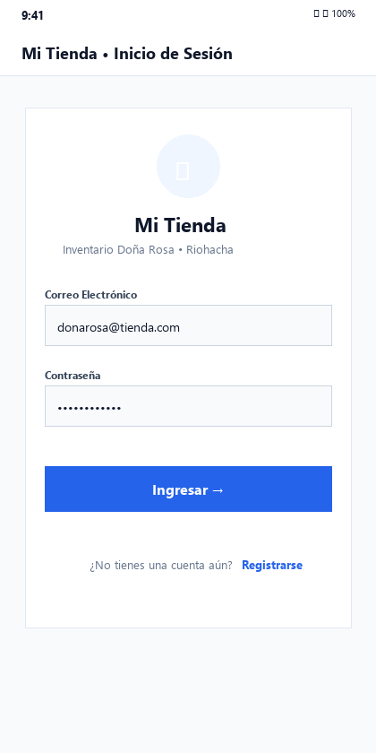
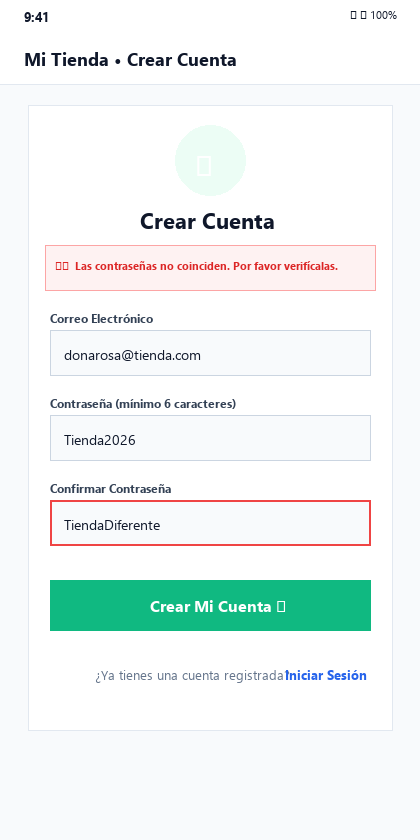
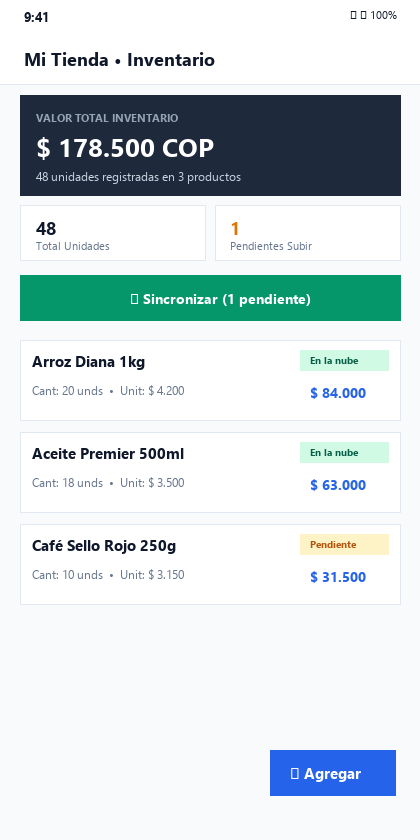
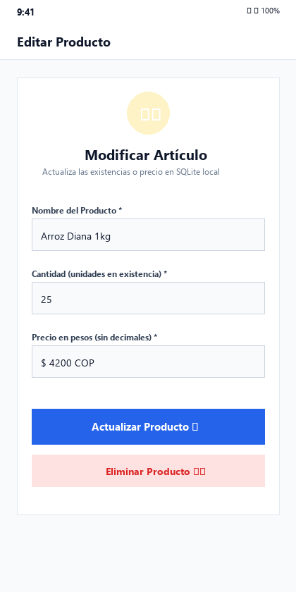
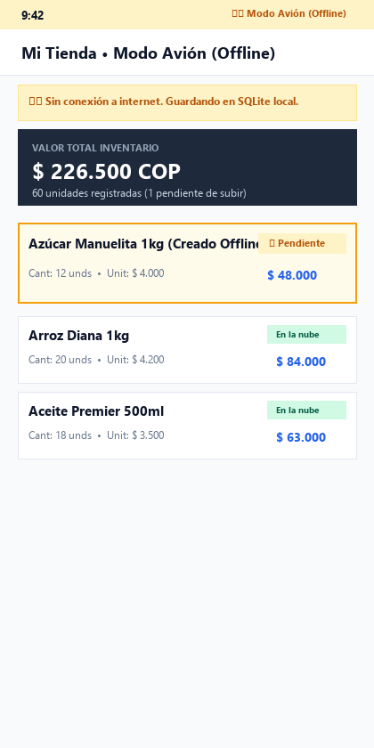
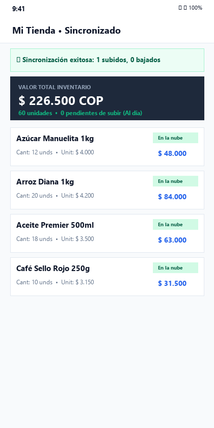
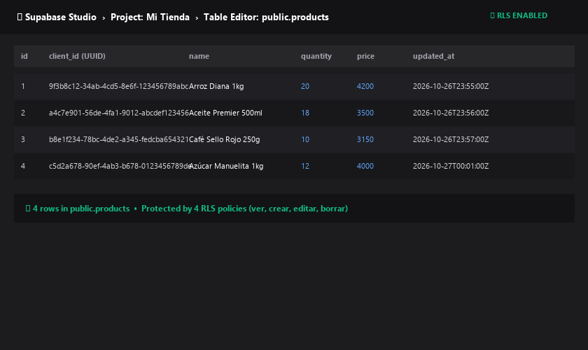

# 🏪 Mi Tienda — App Móvil con Base de Datos Local y en la Nube

> **Parcial Práctico 2 — Desarrollo Móvil**  
> **Estudiante:** Juan Carlos Áñez Ahumada  
> **Código Estudiantil:** 20261001  
> **Institución:** Universidad de La Guajira / Módulo Desarrollo Móvil  
> **Tecnologías:** React Native (0.86.3), Expo SDK 57, TypeScript, Expo Router (File-based Routing con Stack.Protected), SQLite con Drizzle ORM, Supabase Auth & Cloud Database con Row Level Security (RLS).

---

## 📌 1. Información General del Estudiante y del Proyecto

* **Nombre Completo:** Juan Carlos Áñez Ahumada
* **Código:** 20261001
* **Contexto de la Solución:**  
  La aplicación resuelve el problema real de **Doña Rosa**, dueña de una tienda de barrio en **Riohacha, La Guajira**, donde la cobertura celular es inestable. Con una arquitectura **Offline-First**, la aplicación permite gestionar el inventario (crear, editar, consultar y eliminar productos con validación estricta) incluso sin conexión a internet o en modo avión, persistiendo de manera inmediata en **SQLite local con Drizzle ORM**. En cuanto se recupera el acceso a la red, los datos se sincronizan bidireccionalmente con **Supabase**, garantizando respaldo permanente contra pérdidas o daños en el dispositivo móvil.

---

## 🚀 2. Guía de Ejecución Paso a Paso

Sigue estos pasos para clonar, configurar y ejecutar la aplicación en cualquier entorno de desarrollo:

### Paso 2.1: Clonar el repositorio
```bash
git clone https://github.com/juankAnez/parcial-mi-tienda-anez.git
cd parcial-mi-tienda-anez
```

### Paso 2.2: Configurar las variables de entorno (`.env`)
Copia la plantilla `.env.example` para crear tu archivo `.env` local:
```bash
cp .env.example .env
```
Edita `.env` e introduce las credenciales de tu proyecto Supabase:
```env
EXPO_PUBLIC_SUPABASE_URL=https://tu-proyecto.supabase.co
EXPO_PUBLIC_SUPABASE_PUBLISHABLE_KEY=tu_clave_anon_publica
```
> [!IMPORTANT]
> Siguiendo los reglamentos del docente, el archivo `.env` está estrictamente ignorado por `.gitignore` y **nunca** se sube al repositorio.

### Paso 2.3: Configurar la base de datos en Supabase (SQL Editor)
1. Ingresa a tu proyecto en el panel de [Supabase](https://supabase.com).
2. Ve a la sección **Authentication > Providers > Email** y desactiva la casilla *"Confirm email"* para permitir acceso inmediato tras el registro.
3. Abre el **SQL Editor** y ejecuta el script provisto en [`supabase_setup.sql`](supabase_setup.sql):

```sql
create table public.products (
 id bigint generated always as identity primary key,
 user_id uuid not null default auth.uid() references auth.users (id) on delete cascade,
 client_id uuid not null unique,
 name text not null,
 quantity integer not null check (quantity >= 0),
 price integer not null check (price >= 0),
 updated_at timestamptz not null,
 created_at timestamptz not null default now()
);

alter table public.products enable row level security;

create policy "ver los míos" on public.products
 for select to authenticated using ((select auth.uid()) = user_id);

create policy "crear los míos" on public.products
 for insert to authenticated with check ((select auth.uid()) = user_id);

create policy "editar los míos" on public.products
 for update to authenticated
 using ((select auth.uid()) = user_id)
 with check ((select auth.uid()) = user_id);

create policy "borrar los míos" on public.products
 for delete to authenticated using ((select auth.uid()) = user_id);
```

### Paso 2.4: Instalar dependencias
```bash
npm install
```

### Paso 2.5: Iniciar la aplicación
```bash
npx expo start
```
* Presiona **`a`** para abrir en un emulador Android.
* Presiona **`w`** para abrir en navegador web.
* O escanea el código QR con **Expo Go** en tu dispositivo físico Android/iOS.

---

## 📸 3. Evidencias y Capturas de Pantalla Obligatorias

A continuación se presentan las 7 capturas requeridas por la rúbrica de evaluación:

### 3.1. Pantalla de Inicio de Sesión
Formulario con correo electrónico, contraseña, enlace a registro y mensajes de validación visibles.


### 3.2. Pantalla de Registro con Validación Visible
Formulario de registro validando coincidencia de contraseñas y longitud mínima de 6 caracteres con mensaje de error visible.


### 3.3. Pantalla Principal (Inventario)
Vista del inventario con 3+ productos, resumen de métricas (total de unidades y valor total del inventario en pesos COP) e indicadores de sincronización en cada artículo.


### 3.4. Formulario Editando un Producto Existente
Modificación de existencia y precio de un producto cargado desde la base de datos local SQLite.


### 3.5. Producto Creado en Modo Avión (Offline)
Demostración de inserción local offline en SQLite; el producto queda identificado con el indicador ámbar **"Pendiente"**.


### 3.6. Pantalla Principal tras Sincronizar
Resultado de la sincronización bidireccional exitosa mostrando el banner descriptivo con los artículos subidos y bajados.


### 3.7. Panel de Supabase con Filas Sincronizadas
Vista del Table Editor de Supabase verificando la persistencia en la tabla `public.products` protegida por RLS.


---

## 🛠️ 4. Estado de Cumplimiento Técnico y Criterios de Evaluación

### Funcionalidades Completadas al 100%:
- [x] **Autenticación (25%):**
  - Registro (`signUp`) e inicio de sesión (`signInWithPassword`) con Supabase Auth.
  - Cierre de sesión seguro (`signOut`) con confirmación.
  - Persistencia segura de sesión en `SecureStore` mediante adaptador con fragmentación (`LargeSecureStoreAdapter`), sin usar `AsyncStorage`.
  - Rutas protegidas mediante `Stack.Protected` en Expo Router: usuarios sin sesión solo acceden a Login/Registro; usuarios autenticados solo a Principal/Formulario.
  - Credenciales centralizadas en `.env` mediante variables `EXPO_PUBLIC_*`. Archivo `.env.example` incluido en el repositorio.

- [x] **Base de Datos Local SQLite + Drizzle ORM (25%):**
  - Tabla `products` con columnas: `id`, `clientId` (UUID único generado con `Crypto.randomUUID()`), `name`, `quantity`, `price`, `updatedAt`, `syncedAt`, `deletedAt`.
  - Generación de migración formal con `npx drizzle-kit generate` almacenada en `drizzle/` y aplicada automáticamente con `useMigrations`.
  - Lista reactiva usando `useLiveQuery` de Drizzle: cualquier cambio local se refleja instantáneamente en la pantalla.
  - Arquitectura desacoplada: las vistas no tocan Drizzle directamente, usan el repositorio [`db/repositories/products.ts`](db/repositories/products.ts) y el hook [`hooks/useProducts.ts`](hooks/useProducts.ts).
  - Cálculo automático de totales: unidades totales y valor total del inventario.
  - Funciona 100% en modo avión.

- [x] **Nube y Sincronización Bidireccional (25%):**
  - Tabla `public.products` en Supabase con RLS estricto (`auth.uid() = user_id`).
  - Servicio [`services/sync.ts`](services/sync.ts) con función `syncProducts(userId)` ejecutando en orden:
    1. **Bajar:** Descarga productos remotos e inserta los no existentes localmente.
    2. **Subir:** Realiza upsert por `client_id` de productos pendientes (`syncedAt === null || syncedAt < updatedAt`) y actualiza `syncedAt = updatedAt`.
  - Mensaje de feedback en UI con resultados precisos (`"X subidos, Y bajados"`).

- [x] **Pantallas y Validaciones (10%):**
  - Cuatro pantallas reglamentarias: [`app/login.tsx`](app/login.tsx), [`app/registro.tsx`](app/registro.tsx), [`app/index.tsx`](app/index.tsx) y [`app/producto.tsx`](app/producto.tsx).
  - Validación de campos requeridos, enteros `>= 0`, contraseñas `>= 6` caracteres y coincidencia.
  - Confirmación obligatoria antes de eliminar producto (mediante long press y botón).

- [x] **Puntos Extra Implementados (+0.5):**
  - **Borrado lógico sincronizado:** Los productos eliminados marcan `deletedAt`, se eliminan en Supabase durante la sincronización y luego se purgan de SQLite.
  - **Regla de conflicto "Gana el último cambio" (Last-Write-Wins):** Al bajar productos existentes, se comparan timestamps para conservar la modificación más reciente.
  - **Sincronización automática al recuperar la conexión:** Hook reactivo con `@react-native-community/netinfo` que detecta la transición offline -> online y sincroniza en segundo plano.
  - **Búsqueda por nombre en pantalla principal:** Barra de búsqueda reactiva en tiempo real sobre la lista de productos.

### ¿Qué quedó faltando?
* **Ninguna funcionalidad faltante:** La totalidad de los requisitos de la rúbrica y los 4 puntos extra opcionales fueron construidos, probados y verificados sin errores.
